# Backend of a HnH CMS system 
A Backend for a Student Visa Application Processing Agency

## Requirements

### WorkFlow
>A Marketing Team fills a spreadsheet with minimal information about potential leads,
>
>The sheet is imported by a manager into the CRM, with unique key on email, 
>
>The Manager then  Marks potential leads as Approved, 
>
>---
>
>A user Comes online and registers through the website, his acc is made in User’s table, 
>
>He can then submit a req to start Application his data is entered into potential leads table and is marked approved default
>
>---
>
>A user walks in and gives his data, He is entered into the potential leads, as a default of approved, and his acc is also made in the User’s table
>
>---
>
>A Consultant gets all the data in potential leads table with status approved, 
>
>He makes a copy of them in the Application table, 
>
>He contacts each User and gather’s more information, if the user has an account (if he came through the Website, or the walk-in) he only makes Application record, but if user doesn’t have account (came through marketing team) then a user account is made for the user and application made on the user
>
>---
>
>If user’s account is made by consultant or is made by Receptionist, then the password is unset, in the case, user can’t login, he has to register the account,
>
>---
>
>Registration of a user happens through online portal, he enters his email, and get’s an OTP, if verified, it is checked if he has an account, if yes he is just logged into it , and is prompted to set a password, is user with a password already exists then error message says “User already exists, please login”. If the user doesn’t have an account, basic information is gathered and a new User is made
>
>---
>
>If a user has submitted a req for application, he gets it’s live status, if it’s still with the Consultant and is not yet made into an application, then the Application status is set to not made yet,  and the user may open up a form and enter his data req for Application record, which the Consultant can just approve to make it an actual application
>
>---
>
>After data is gathered, Consultant generates an Invoice for the application and forwards it to the Accountant, (special status of type set to university means has to be delayed for university to pay) 
>
>---
>
>When an Accountant get’s an invoice, he can contact the user for the payment, any method can be used for payment but once the payment is confirmed by the Accountant, Consultant takes back control
>
>---
>
>After a payment is made, a consultant makes a day task on an application, visible to the student, and tries to gather all documents needed for the process and tries to get them verified, 
>
>---
>
>Once all the documents needed are gathered and Verified, the Consultant makes the application status to documents done
>
>---
>
>Applications with documents done are visible to backend officer (or agent) who then makes day tasks on the applications and applies for visa and application submission and etc
>
>
>---
> .

### Mermaid Flowchart Graph

```mermaid
---
config:
  theme: dark
  flowchart:
    curve: basis
    nodeSpacing: 50
    rankSpacing: 80
  layout: elk
  elk:
    mergeEdges: true
    nodePlacementStrategy: SIMPLE
---
flowchart LR
 subgraph MARKETING_FLOW["🎯 Marketing Team Flow<br>━━━━━━━━━━━━━━━━━━━━<br>📊 Lead: PENDING<br>👤 User: NO ACCOUNT"]
    direction TB
        MT1[/"📊 Marketing Team<br>Fills Spreadsheet"/]
        MT2[("📁 Spreadsheet<br>Data")]
        MT3["📤 Manager Imports<br>to CRM"]
        MT4{"🔑 Unique Key<br>Check Email"}
        MT5["✅ Lead Created<br>Status: PENDING"]
        MT6["❌ Duplicate<br>Email Error"]
  end
 subgraph ONLINE_FLOW["🌐 Online Registration Flow<br>━━━━━━━━━━━━━━━━━━━━<br>📊 Lead: APPROVED<br>👤 User: HAS PASSWORD"]
    direction TB
        ON1["🖥️ User Visits<br>Website"]
        ON2["📧 Enter Email"]
        ON3["📨 Send OTP"]
        ON4{"🔐 OTP<br>Verified?"}
        ON5{"👤 Account<br>Exists?"}
        ON6{"🔑 Has<br>Password?"}
        ON7["❌ Invalid OTP"]
        ON8["🔄 Login &amp; Set<br>Password Prompt"]
        ON9["❌ User Exists<br>Please Login"]
        ON10["📝 Gather Basic<br>Info"]
        ON11["✅ Create User<br>Account"]
        ON12["📋 Submit App<br>Request"]
        ON13["✅ Lead Created<br>Status: APPROVED"]
  end
 subgraph WALKIN_FLOW["🚶 Walk-in Flow<br>━━━━━━━━━━━━━━━━━━━━<br>📊 Lead: APPROVED<br>👤 User: NO PASSWORD"]
    direction TB
        WI1["🚶 User Walks In"]
        WI2["📝 Receptionist<br>Collects Data"]
        WI3["✅ Create User<br>Account - No Password"]
        WI4["✅ Lead Created<br>Status: APPROVED"]
  end
 subgraph LEAD_SOURCES["📥 LEAD ENTRY SOURCES<br>━━━━━━━━━━━━━━━━━━━━━━━━━━━━<br>📊 Lead Status: PENDING or APPROVED<br>📁 App Status: NOT YET CREATED<br>👤 User Status: Varies by source"]
    direction TB
        MARKETING_FLOW
        ONLINE_FLOW
        WALKIN_FLOW
  end
 subgraph LEAD_MGMT["📋 LEAD MANAGEMENT<br>━━━━━━━━━━━━━━━━━━━━━━━━━━━━<br>📊 Lead Status: PENDING → APPROVED/REJECTED<br>📁 App Status: NOT YET CREATED"]
    direction TB
        LM1[("💾 Potential<br>Leads Table")]
        LM2{"📊 Lead<br>Source?"}
        LM3["⏳ Status:<br>PENDING"]
        LM4["👀 Manager<br>Reviews"]
        LM5{"✅ Approve<br>Lead?"}
        LM6["✅ Status:<br>APPROVED"]
        LM7["❌ Status:<br>REJECTED"]
  end
 subgraph CONSULTANT_PROC["👨‍💼 CONSULTANT PROCESSING<br>━━━━━━━━━━━━━━━━━━━━━━━━━━━━<br>📊 Lead Status: APPROVED<br>📁 App Status: NOT CREATED → CREATED<br>👤 User: Created if missing - no password"]
    direction TB
        CP1["👁️ View Approved<br>Leads"]
        CP2{"👤 User Has<br>Account?"}
        CP3["📞 Contact User<br>Gather Info"]
        CP4["✅ Create User<br>Account - No Password"]
        CP5["📋 Create Application<br>Record"]
        CP6[("💾 Applications<br>Table")]
  end
 subgraph USER_STATUS["📱 USER APPLICATION VIEW<br>━━━━━━━━━━━━━━━━━━━━━━━━━━━━<br>📁 App Status: NOT MADE YET → FORM SUBMITTED<br>👤 User can fill pre-application form"]
    direction TB
        US1["👤 User Checks<br>Application Status"]
        US2{"📊 Application<br>Created?"}
        US3["📋 Status: NOT MADE YET<br>Show Form Option"]
        US4["📝 User Fills<br>Pre-Application Form"]
        US5["⏳ Awaiting Consultant<br>Approval"]
        US6["✅ Consultant<br>Approves"]
        US7["📊 Show Live<br>Application Status"]
  end
 subgraph PAYMENT_PROC["💰 INVOICE &amp; PAYMENT<br>━━━━━━━━━━━━━━━━━━━━━━━━━━━━<br>📁 App Status: INVOICE_GENERATED →<br>PAYMENT_PENDING → PAYMENT_COMPLETE"]
    direction TB
        PP1["📄 Generate<br>Invoice"]
        PP2{"💼 Payment<br>Type?"}
        PP3["🏫 University Pays<br>- Delayed"]
        PP4["👤 User Pays<br>- Direct"]
        PP5["📨 Forward to<br>Accountant"]
        PP6["📞 Accountant Contacts<br>User for Payment"]
        PP7{"💳 Payment<br>Method"}
        PP8["🏦 Bank<br>Transfer"]
        PP9["💵 Cash"]
        PP10["💳 Card"]
        PP11{"✅ Payment<br>Confirmed?"}
        PP12["✅ Payment<br>COMPLETE"]
        PP13["⏳ Payment<br>PENDING"]
        PP14["🔄 Control Returns<br>to Consultant"]
  end
 subgraph DOC_PROC["📁 DOCUMENT PROCESSING<br>━━━━━━━━━━━━━━━━━━━━━━━━━━━━<br>📁 App Status: DOCUMENTS_PENDING →<br>DOCUMENTS_DONE<br>📋 Day Tasks: VISIBLE TO STUDENT"]
    direction TB
        DP1["📋 Create Day<br>Task on Application"]
        DP2["👁️ Task Visible<br>to Student"]
        DP3["📤 Gather Required<br>Documents"]
        DP4{"📋 All Docs<br>Collected?"}
        DP5["✅ Verify<br>Documents"]
        DP6{"✅ All Docs<br>Verified?"}
        DP7["📝 Request Missing<br>Documents"]
        DP8["❌ Re-submit<br>Invalid Docs"]
        DP9["✅ Status:<br>DOCUMENTS DONE"]
  end
 subgraph BACKEND_PROC["🛫 BACKEND OFFICER PROCESSING<br>━━━━━━━━━━━━━━━━━━━━━━━━━━━━<br>📁 App Status: WITH_BACKEND → SUBMITTED →<br>PROCESSING → COMPLETE"]
    direction TB
        BP1["👁️ View Applications<br>with DOCS DONE"]
        BP2["📋 Create Day<br>Tasks"]
        BP3["📝 Prepare Visa<br>Application"]
        BP4["📤 Submit<br>Application"]
        BP5{"✅ Submission<br>Successful?"}
        BP6["⏳ Status:<br>PROCESSING"]
        BP7["❌ Submission<br>Failed - Retry"]
        BP8["✅ Status:<br>SUBMITTED"]
        BP9["🎉 Application<br>COMPLETE"]
  end
 subgraph DATABASES["🗄️ DATABASE TABLES"]
    direction TB
        DB1[("👥 Users<br>Table")]
        DB2[("📋 Potential<br>Leads Table")]
        DB3[("📁 Applications<br>Table")]
        DB4[("💰 Invoices<br>Table")]
  end
    MT1 --> MT2
    MT2 --> MT3
    MT3 --> MT4
    MT4 -- Unique --> MT5
    MT4 -- Exists --> MT6
    ON1 --> ON2
    ON2 --> ON3
    ON3 --> ON4
    ON4 -- No --> ON7
    ON7 --> ON2
    ON4 -- Yes --> ON5
    ON5 -- Yes --> ON6
    ON5 -- No --> ON10
    ON10 --> ON11
    ON6 -- "No - Unset" --> ON8
    ON6 -- Yes --> ON9
    ON11 --> ON12
    ON12 --> ON13
    ON8 --> ON12
    WI1 --> WI2
    WI2 --> WI3
    WI3 --> WI4
    LM1 --> LM2
    LM2 -- From Marketing --> LM3
    LM3 --> LM4
    LM4 --> LM5
    LM2 -- "From Online/Walk-in" --> LM6
    LM5 -- Yes --> LM6
    LM5 -- No --> LM7
    CP1 --> CP2
    CP2 -- "Yes - Online/Walk-in" --> CP3
    CP2 -- "No - Marketing" --> CP4
    CP4 --> CP3
    CP3 --> CP5
    CP5 --> CP6
    US1 --> US2
    US2 -- No --> US3
    US3 --> US4
    US4 --> US5
    US5 --> US6
    US2 -- Yes --> US7
    US6 --> US7
    PP1 --> PP2
    PP2 -- University --> PP3
    PP3 --> PP5
    PP2 -- Standard --> PP4
    PP4 --> PP5
    PP5 --> PP6
    PP6 --> PP7
    PP7 --> PP8 & PP9 & PP10
    PP8 --> PP11
    PP9 --> PP11
    PP10 --> PP11
    PP11 -- Yes --> PP12
    PP12 --> PP14
    PP11 -- No --> PP13
    PP13 --> PP6
    DP1 --> DP2
    DP2 --> DP3
    DP3 --> DP4
    DP4 -- No --> DP7
    DP7 --> DP3
    DP4 -- Yes --> DP5
    DP5 --> DP6
    DP6 -- No --> DP8
    DP8 --> DP3
    DP6 -- Yes --> DP9
    BP1 --> BP2
    BP2 --> BP3
    BP3 --> BP4
    BP4 --> BP5
    BP5 -- Yes --> BP6
    BP6 --> BP8
    BP8 --> BP9
    BP5 -- No --> BP7
    BP7 --> BP4
    MT5 --> LM1
    ON13 --> LM1
    WI4 --> LM1
    LM6 --> CP1
    CP6 --> US1 & PP1
    PP14 --> DP1
    DP9 --> BP1

     MT1:::marketing
     MT2:::database
     MT3:::manager
     MT4:::decision
     MT5:::status
     MT6:::error
     ON1:::user
     ON2:::user
     ON3:::status
     ON4:::decision
     ON5:::decision
     ON6:::decision
     ON7:::error
     ON8:::user
     ON9:::error
     ON10:::user
     ON11:::success
     ON12:::user
     ON13:::status
     WI1:::user
     WI2:::receptionist
     WI3:::receptionist
     WI4:::status
     LM1:::database
     LM2:::decision
     LM3:::status
     LM4:::manager
     LM5:::decision
     LM6:::success
     LM7:::error
     CP1:::consultant
     CP2:::decision
     CP3:::consultant
     CP4:::consultant
     CP5:::consultant
     CP6:::database
     US1:::user
     US2:::decision
     US3:::status
     US4:::user
     US5:::status
     US6:::consultant
     US7:::success
     PP1:::consultant
     PP2:::decision
     PP3:::status
     PP4:::status
     PP5:::consultant
     PP6:::accountant
     PP7:::decision
     PP8:::accountant
     PP9:::accountant
     PP10:::accountant
     PP11:::decision
     PP12:::success
     PP13:::status
     PP14:::consultant
     DP1:::consultant
     DP2:::status
     DP3:::consultant
     DP4:::decision
     DP5:::consultant
     DP6:::decision
     DP7:::consultant
     DP8:::error
     DP9:::success
     BP1:::backend
     BP2:::backend
     BP3:::backend
     BP4:::backend
     BP5:::decision
     BP6:::status
     BP7:::error
     BP8:::success
     BP9:::success
     DB1:::database
     DB2:::database
     DB3:::database
     DB4:::database
    classDef marketing fill:#e67e22,stroke:#d35400,color:#fff,stroke-width:2px
    classDef manager fill:#9b59b6,stroke:#8e44ad,color:#fff,stroke-width:2px
    classDef user fill:#27ae60,stroke:#1e8449,color:#fff,stroke-width:2px
    classDef receptionist fill:#1abc9c,stroke:#16a085,color:#fff,stroke-width:2px
    classDef consultant fill:#3498db,stroke:#2980b9,color:#fff,stroke-width:2px
    classDef accountant fill:#f1c40f,stroke:#d4ac0d,color:#1a1a2e,stroke-width:2px
    classDef backend fill:#e74c3c,stroke:#c0392b,color:#fff,stroke-width:2px
    classDef status fill:#2c3e50,stroke:#34495e,color:#ecf0f1,stroke-width:2px
    classDef error fill:#c0392b,stroke:#a93226,color:#fff,stroke-width:2px
    classDef database fill:#1a1a2e,stroke:#4a4a6a,color:#ecf0f1,stroke-width:2px
    classDef decision fill:#34495e,stroke:#5dade2,color:#ecf0f1,stroke-width:2px
    classDef success fill:#1e8449,stroke:#27ae60,color:#fff,stroke-width:2px
```

## 